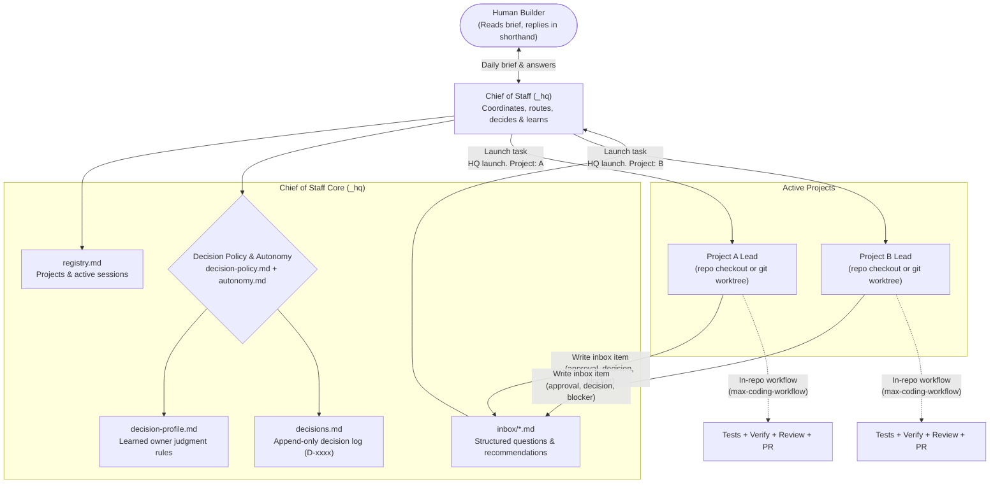

# Chief of Staff Workspace Kit (`_hq`)

A plain-language guide to how the Chief of Staff kit works, how it coordinates multi-project AI development across harnesses, and how it pairs with in-repo coding workflows.

---

## Why this workspace kit exists

When you build multiple applications with AI coding agents, managing them quickly turns into chaos. You end up juggling multiple terminal tabs or chat sessions. In every project, agents ask for the same decisions, repeat mistakes, lose track of context, or quietly make poor assumptions when left unattended.

Context windows get cleared. Sessions restart. Preferences get forgotten.

**The core idea: a dedicated Chief of Staff for all your projects.** Instead of babysitting every agent session yourself, you talk to **one coordinator** located in a central folder at your workspace root (`_hq/`). 

Your Chief of Staff coordinates work across all your project repositories:
- Routes tasks to dedicated Project Lead agents.
- Collects questions, approvals, and blockers in a structured inbox.
- Learns your personal preferences in an Owner Judgment Profile.
- Earns autonomy over time so it can answer routine questions on your behalf.
- Sends you concise, scannable briefs and handles your shorthand replies.
- Coordinates without writing app code—staying focused on the big picture.

---

## Who it is for

This kit is built for **builders, operators, founders, and solo makers** managing two or more software projects with AI coding agents.

If you use AI tools like Claude Code, Google Antigravity (AGY), Cursor, OpenAI Codex, or OpenCode, you want agents to make steady progress without stalling. At the same time, you cannot afford to hand over blind trust on critical decisions (security, data storage, user-facing behavior, or money). 

The Chief of Staff kit gives you the sweet spot: **autonomous execution with calibrated human oversight**.

---

## How it pairs with `max-coding-workflow`

The Chief of Staff kit is designed to pair seamlessly with `plugins/max-coding-workflow` (or any repo-level coding workflow).

They operate at two distinct levels:

| Layer | Where it lives | What it manages |
|---|---|---|
| **Meta-Orchestrator (`_hq`)** | Workspace root (`_hq/`) | Project registry, task dispatch, cross-repo priorities, decision triage, owner judgment learning, daily briefs |
| **In-Repo Workflow (`max-coding-workflow`)** | Each project repo (`my-app/`) | Seven-phase build loop: specifications, test-driven coding, test-mutation probing, verification gates, pull requests, independent code reviews, human acceptance checks |

### The Bridge: `PROTOCOL.md`

In a standalone project using `max-coding-workflow`, whenever the agent encounters a choice, plan approval, or blocker, it pauses and asks the user in chat.

When operating under HQ, the project lead follows `PROTOCOL.md`:
1. **Replaces "ask the user" with an inbox item:** Instead of interrupting you, the lead writes a structured Markdown file in `_hq/inbox/` with lettered options, trade-offs, and a recommendation.
2. **Checks the decision policy:** Routine choices are resolved by HQ using your learned preferences; only decisions requiring your judgment reach your brief.
3. **Phase-based handovers:** When a phase completes (e.g., planning approved or build ready for human check), the lead writes a handover file and finishes. HQ then launches the next fresh session or alerts you for the final check.

---

## Works across any harness (100% Standalone)

HQ relies entirely on plain Markdown files, git worktrees, and shell commands. It does not require a proprietary agent server, cloud daemon, or external database.

You can run HQ directly in whichever tool you prefer:

| Harness | Launch a Project Lead | Resume / send answer | Parallel isolation |
|---|---|---|---|
| **Claude Code** | `claude -p "<prompt>" --cwd <repo_or_worktree>` or native `Agent` | `claude -p "<answer>" --resume <session_id>` or message subagent | `isolation: "worktree"` or `git worktree` |
| **Google Antigravity (AGY)** | `invoke_subagent` (`Workspace: "branch"` or `"share"`), or `agy` CLI | Message subagent or update inbox item | Branch/share workspace or `git worktree` |
| **Cursor** | Open project / worktree in separate window; run in Composer | Paste decision or save to `_hq/inbox/` | Separate window per `git worktree` |
| **OpenAI Codex** | `codex exec -C <repo_or_worktree> "<prompt>"` or `spawn_agent` | `codex exec resume <session_id> "<answer>"` | `git worktree` |
| **OpenCode** | `opencode run --dir <repo_or_worktree> "<prompt>"` | `opencode run --dir <repo_or_worktree> --session <id> "<answer>"` | `git worktree` |
| *Orchestrator (optional)* | *`t3_thread_launch` (or `t3 thread start`)* | *`t3_thread_send`* | *Worktree strategy* |

---

## Standalone setups: Step-by-step guides

### 1. Claude Code Standalone
Run Claude Code directly in your terminal without any external UI:
1. **Chief of Staff session:** Start Claude in your `_hq/` directory:
   ```bash
   cd ~/DevProjects/_hq && claude
   ```
2. **Dispatching Project Leads:** HQ dispatches a lead in a repository or worktree non-interactively:
   ```bash
   claude -p "HQ launch. Project: web-client. First read ~/DevProjects/_hq/PROTOCOL.md..." --cwd ~/DevProjects/web-client
   ```
   Or use native subagents with the `Agent` tool (`isolation: "worktree"`).
3. **Question handling:** The lead writes questions to `_hq/inbox/`. HQ reviews them during status updates or briefs.
4. **Resuming:** Deliver answers with:
   ```bash
   claude -p "D-0014: Option B approved" --resume <session_id>
   ```

### 2. Google Antigravity (AGY) Standalone
Run Antigravity using the IDE or the `agy` CLI:
1. **Chief of Staff session:** Open the `_hq/` directory as your active workspace in Antigravity.
2. **Dispatching Project Leads:** Launch child leads using native subagent capabilities:
   - Invoke subagents configured for specific projects with isolated workspace modes (`Workspace: "branch"` or `Workspace: "share"`).
   - Alternatively, execute background tasks in project directories via the terminal.
3. **Question handling:** Project Leads follow `PROTOCOL.md` and file questions into `_hq/inbox/`.
4. **Answering:** HQ inspects `inbox/`, applies the decision policy, and updates the subagent or inbox status directly.

### 3. Cursor Standalone
Run HQ seamlessly across multi-window Cursor setups:
1. **Chief of Staff session:** Open `_hq/` in a dedicated Cursor workspace window. Talk to your Chief of Staff in Composer or Chat.
2. **Dispatching Project Leads:** Open each project repository (or git worktree) in its own Cursor window.
3. **Starting work:** Paste the standard launch prompt into Composer (Agent mode):
   ```text
   HQ launch. Project: mobile-app.
   First read ~/DevProjects/_hq/PROTOCOL.md, then this repo's rules file.
   Task: run /start and propose the next ready item.
   Decisions on record for this task: none.
   ```
4. **Question handling:** When the lead needs an approval or architectural decision, it writes to `_hq/inbox/<project>-<slug>.md` and stops.
5. **Decisions:** In your `_hq/` window, Chief of Staff reads open inbox files, prepares your daily brief, and records decisions in `decisions.md`. You or HQ provide the chosen option back to the project Composer.

### 4. OpenAI Codex Standalone
Run Codex directly via the CLI:
1. **Chief of Staff session:** Start Codex in `_hq/`:
   ```bash
   cd ~/DevProjects/_hq && codex
   ```
2. **Dispatching Project Leads:** Execute non-interactive lead commands:
   ```bash
   codex exec -C ~/DevProjects/backend-api "HQ launch. Project: backend-api..."
   ```
   Or use native `spawn_agent`.
3. **Resuming:** Send answers or follow-up instructions via:
   ```bash
   codex exec resume <session_id> "D-0021: Proceed with SQLite cache"
   ```

### 5. OpenCode Standalone
Run OpenCode in terminal:
1. **Chief of Staff session:** Start OpenCode in `_hq/`:
   ```bash
   cd ~/DevProjects/_hq && opencode
   ```
2. **Dispatching Project Leads:** Run tasks in project directories:
   ```bash
   opencode run --dir ~/DevProjects/web-client "HQ launch. Project: web-client..."
   ```
3. **Resuming:** Resume with:
   ```bash
   opencode run --dir ~/DevProjects/web-client --session <id> "Answer to question"
   ```

---

## Parallel Work with Git Worktrees

To run parallel leads on the same codebase without collisions or lockfile conflicts, create an isolated `git worktree`:

```bash
# Create an isolated checkout on a new branch
git -C ~/DevProjects/my-app worktree add ../my-app-BL-012 -b feat/BL-012

# Run your lead agent inside that worktree directory
# When the pull request is merged, clean up
git -C ~/DevProjects/my-app worktree remove ../my-app-BL-012
```

---

## How the system flows



---

## The decision engine & autonomy ladder

The heart of the Chief of Staff is its ability to handle choices without bothering you, while never overstepping its boundaries.

### Three decision tiers

Every question from a lead is categorized into one of three tiers:

- **Low (Safe to decide):** Easy to undo, invisible to end users, or within an approved specification (`bugfix`, `refactor`, `dependency`, `tooling`, `copy-fix`).
- **Medium (Shapes direction):** Reversible in approximately a day, but guides future work (`backlog-order`, `scope-cut`, `tech-choice`, `requirement-detail`).
- **High (Hard to undo):** One-way doors, user-facing behavior, visual design, or core system architecture (`ui`, `app-logic`, `architecture`, `new-feature`).

*Rule of thumb:* When in doubt, the system picks the higher tier.

### The Never-Auto list

Certain domains are **strictly High forever** and can never be decided autonomously by the AI, regardless of its autonomy score:
- Security, authentication, secrets, and permissions
- User data handling, storage, migration, or deletion
- Money, payments, pricing, and paid third-party services
- Production deployments, app store submissions, making repositories public
- Public communication (emails, public posts, messaging)
- Legal terms, licensing, and privacy policies

### The Autonomy Ladder

Autonomy is earned per project and per category through proven alignment with your judgment:

```text
ask  -->  propose  -->  decide (and inform)
```

1. **`ask`**: HQ lists the lettered options. Any recommendation is marked only as an unverified guess.
2. **`propose`**: HQ marks its recommended choice with a one-line rationale, citing specific rules from your judgment profile.
3. **`decide`**: HQ selects the option, transmits the instruction to the project lead, logs it in `decisions.md`, and **informs you in the next brief** under *"Decided for you"*.

> [!IMPORTANT]
> **Decide always means decide and inform.** HQ never takes action silently. Every autonomous decision appears in your next brief with its identifier (`D-xxxx`), giving you full veto power before work progresses too far.

### Earning promotion

HQ starts at **`propose`** for all standard categories. It earns promotion to **`decide`** only after building a consistent track record:
- **Low tier:** At least 10 proposals, with at least 9 of the last 10 matching your choice exactly.
- **Medium tier:** At least 25 proposals in that project and category, with a 95% or higher match rate.
- **High tier:** Never promoted to autonomous decide (unless an explicit milestone trial is approved).

If you veto a decision, or if an underlying model switch occurs, the category drops back to `propose`.

---

## Owner Judgment Profile (`decision-profile.md`)

When you answer questions, your reasoning is captured as reusable rules in `decision-profile.md`.

For example:
```markdown
- **R-1:** Prefer native framework UI components over custom CSS for internal admin screens (from D-0012; confirmations: 4).
- **R-2:** Defer background job queues until MVP volume requires them; use synchronous processing first (from D-0019; confirmations: 2).
```

When an agent proposes an option, it must cite these rules:
`→ I recommend option B: simpler UX, defer analytics (rules R-1, R-2)`.

Over time, your Chief of Staff develops an accurate model of how you think and make trade-offs.

---

## Role tiers & model routing (`routing.md` & `roles/`)

To keep costs down and quality high, tasks are split across specialized roles and model tiers:

| Tier | Role | Purpose | Model characteristics |
|---|---|---|---|
| `route` | Chief of Staff | Coordinates, triages inbox, writes briefs, never codes | High-reasoning model |
| `judge` | Product Architect | Complex planning, architecture specs, ADR evaluations | High-reasoning model |
| `lead` | Project Lead | In-repo lead: plans, dispatches tasks, merges PRs | Balanced or high-reasoning coding model |
| `build` | Implementer | Builds a ready requirement in an isolated worktree | Fast, focused coding model |
| `review` | Code & Security Reviewer | Adversarial review over git diffs | High-reasoning model (**different family from author**) |
| `fast` | Explorer & Q-Rounds | Codebase exploration, question rounds, log digestion | Lightweight, low-cost model |

### Core safety rules

1. **Cross-family reviews:** The code reviewer must never belong to the same model family as the author who wrote the code. Independent eyes catch blind spots.
2. **Spec gate:** Fast implementer models are only assigned tasks after the requirement and acceptance criteria are thoroughly specified and unblocked.
3. **One writer per checkout:** Parallel agents work in isolated `git worktree` directories, never modifying the same checkout simultaneously.

---

## The Daily Ritual & Concise Brief

You interact with HQ through concise daily summaries or on-demand status checks.

### The brief format

When you request an update (or on a morning schedule), HQ presents a clean, scannable brief:

```text
1. Needs you:
   [1] payment-provider: Stripe vs LemonSqueezy for EU tax handling
       A) Stripe Elements with Tax
       B) LemonSqueezy merchant of record

2. My pick:
   [2] cache-strategy: Redis vs in-memory SQLite cache
       A) Redis service
       B) In-memory SQLite
       → I'd pick B: keeps deployment single-container for MVP (rules R-2)

3. Check this:
   - mobile-app: User onboarding flow ready for acceptance test (branch: feat/BL-004)

4. Decided for you:
   - D-0042: Bumped image-picker dependency to patch release (Low: dependency)
   (Reply with a D-id to give feedback or veto)

5. Running:
   - web-client: BL-012 implementing table pagination (Lead active)
```

### Answering in shorthand

You do not need to write long paragraphs. Shorthand is parsed naturally:

```text
1B 2B: keep it simple for now D-0042: good
```

HQ routes the answers to the respective project leads, updates the decision log, reinforces the judgment rules, and gets back to work.

---

## What the kit creates in your workspace

```text
_hq/
  AGENTS.md                    Operating rules for Chief of Staff (coordinates, never codes)
  CLAUDE.md / GEMINI.md        Tool-specific launcher rules
  PROTOCOL.md                  The protocol project leads and workers follow
  registry.md                  Registered projects, repos, harnesses, and active items
  routing.md                   Model tiers, role assignments, and execution modes
  decision-policy.md           Tiers, categories, autonomy ladder, and never-auto list
  decision-profile.md          Learned owner judgment rules (R-1, R-2, ...)
  autonomy.md                  Counters tracking proposals vs. matches per category
  decisions.md                 Append-only history of every decision taken (D-0001, ...)
  state.md                     Rolling memory across session context resets
  ideas.md                     Parked ideas, priority order, and revisit triggers
  skills.md                    Catalog of standard skills followed across projects
  inbox/
    TEMPLATE.md                Standard format for leads asking decisions or approvals
    archive/                   Closed inbox items archived by month
  roles/                       Scoped briefs for subagents (explorer, implementer, reviewer, etc.)
  standards/                   Language and security standards for reviews and code quality
  bin/
    install-git-guard.sh       Git hook preventing accidental force-pushes across projects
    usage-by-project.py        Token and cost estimation script from local logs
```

---

## Quick Start: 5-minute setup

### 1. Copy the kit
Copy the starter kit folder into your workspace root as `_hq`:

```bash
cp -R kits/chief-of-staff/ /path/to/your/workspace/_hq
```

### 2. Configure placeholders
Search and replace the placeholders across files in `_hq/`:
- `<OWNER>`: Your name or handle
- `<WORKSPACE_ROOT>`: Absolute path to your workspace directory (e.g. `/Users/alex/DevProjects`)
- `<GITHUB_OWNER>`: Your GitHub user or organization
- `<WORKFLOW_SKILL>`: Your in-repo workflow skill name (e.g. `max-coding-workflow`)

### 3. Register your projects
Edit `_hq/registry.md` to list your active repositories, their paths, rules files, and preferred lead models.

### 4. Choose your execution mode
Open `_hq/routing.md` and select how you want HQ to launch leads:
- Standalone CLI runner (`claude`, `codex`, `opencode`)
- Native subagents in Antigravity or Claude Code
- Multi-window workspace in Cursor
- *(Optional orchestrator if you use one)*

### 5. Install the git push safety guard
Run the helper script to protect your repositories from destructive commands:

```bash
bash _hq/bin/install-git-guard.sh
```

### 6. Start your first session
Open a terminal or chat in `_hq/`, launch your favorite agent, and say:

```text
start
```

Your Chief of Staff will read the current state, inspect the project registry, report any pending items, and ask what you want to achieve today.
